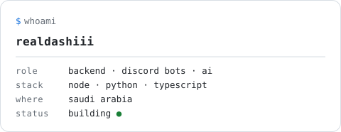

<h1 align="center">realdashiii</h1>

  <b>Backend developer · Discord bots · AI tooling</b> 
  📍 Saudi Arabia &nbsp;·&nbsp; content creator &amp; dev

  
  
  
  
  

---

I build the unglamorous parts that make things work: **Discord bots**, **backend services**, and **AI-powered tools**. If it can be automated, self-hosted, or wired up to a model — I'm probably already building it.

I care about small, fast, reliable software: a bot that just runs, an API that answers instantly, an LLM pipeline that actually saves someone time.

## What I build

- **Discord bots** — moderation, utilities, and custom integrations in Node.js & Python. Slash commands, sharding, per-guild config, databases.
- **Backends & APIs** — REST services, auth, queues, webhooks, and dashboards. Node.js and Python, built to stay up.
- **AI tooling** — LLM wrappers, prompt pipelines, agents, and local model setups that solve a real problem instead of a demo one.
- **Websites** — clean, fast frontends and portfolios with a terminal-ish edge.

## Stack

  

**Languages** — TypeScript · JavaScript · Python · SQL 
**Backend** — Node.js · Express · FastAPI · discord.js / discord.py 
**Data & infra** — PostgreSQL · MongoDB · Redis · Docker · Linux · GitHub Actions 
**AI** — LLM APIs · PyTorch · local models · prompt pipelines

## GitHub

  <picture>
    <source media="(prefers-color-scheme: dark)" srcset="https://github-readme-stats.vercel.app/api?username=TheRealDashiii&show_icons=true&hide_border=true&hide_title=true&theme=dark&bg_color=00000000">
    
  </picture>

## Terminal

  <picture>
    <source media="(prefers-color-scheme: dark)" srcset="assets/terminal-dark.svg">
    <source media="(prefers-color-scheme: light)" srcset="assets/terminal-light.svg">
    
  </picture>

## Elsewhere

- **Website** — [dashiii-dev.vercel.app](https://dashiii-dev.vercel.app)
- **X** — [@realdashiii](https://x.com/realdashiii)
- **YouTube** — [@realdashiii](https://youtube.com/@realdashiii)
- **Twitch** — [twitch.tv/realdashiii](https://twitch.tv/realdashiii)
- **Discord** — `realdashiii`

---

  Build it. Break it. Understand it. Repeat.

<!--
  Publish this profile README:
  1. Create a public repo named exactly "TheRealDashiii" (same as your username).
  2. Put this README.md at the root, plus the assets/ folder.
  3. GitHub shows it on your profile automatically.

  Notes
  - Stats card needs public repos to show real numbers. Delete the "GitHub"
    section until then, if you prefer.
  - Optional top-languages card (add it once you have repos, inside the same
    
 as the stats card):
      <picture>
        <source media="(prefers-color-scheme: dark)" srcset="https://github-readme-stats.vercel.app/api/top-langs/?username=TheRealDashiii&layout=compact&hide_border=true&hide_title=true&theme=dark&bg_color=00000000">
        
      </picture>
  - Terminal card: assets/terminal-light.svg and assets/terminal-dark.svg.
    Edit the text inside them to change the details.
  - Links use @realdashiii on X / YouTube / Twitch. Update if a handle changes.
-->
